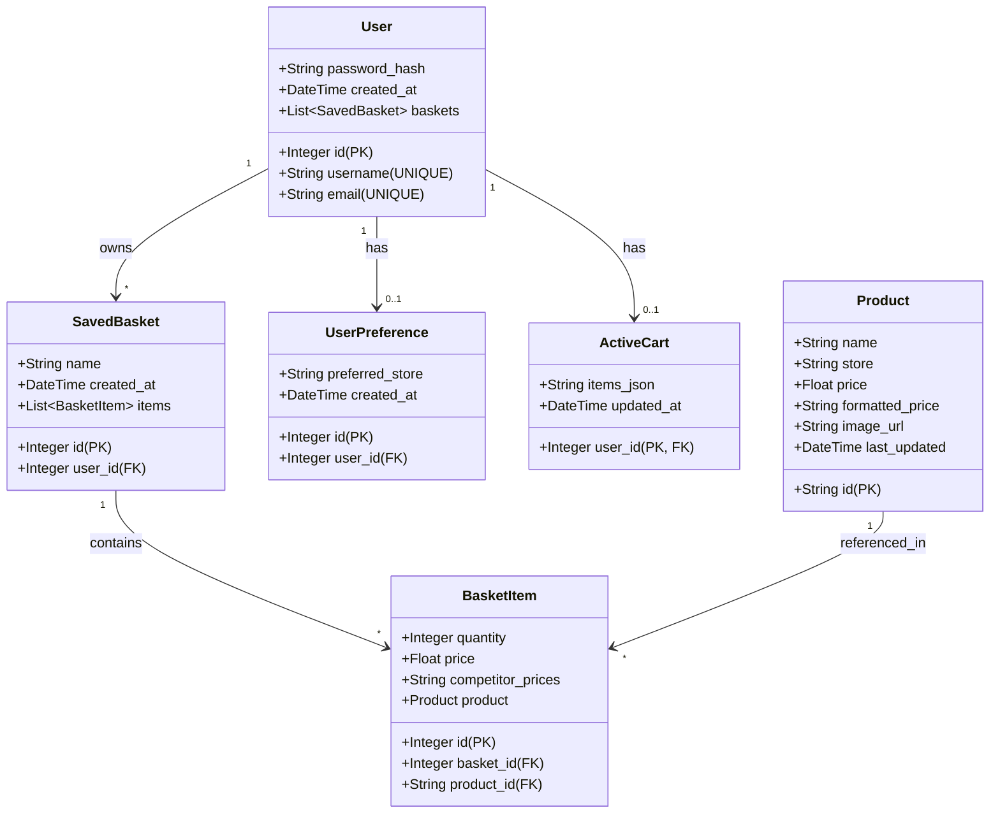

# SmartBasket UML Class Diagram

## Class Details

### User
- Manages user accounts with authentication
- Has many saved baskets
- Can have preferences and an active cart

### Product
- Represents products from different stores
- Tracks price and product information
- Referenced by basket items for price comparison

### UserPreference
- Stores user's preferred store
- One-to-one relationship with User

### ActiveCart
- Tracks the user's current shopping session
- Stores items as JSON
- One-to-one relationship with User

### SavedBasket
- Container for saved shopping baskets
- Can belong to a user (nullable for guest baskets)
- Contains multiple basket items

### BasketItem
- Individual item in a saved basket
- Links products to baskets
- Stores quantity, price, and competitor prices
