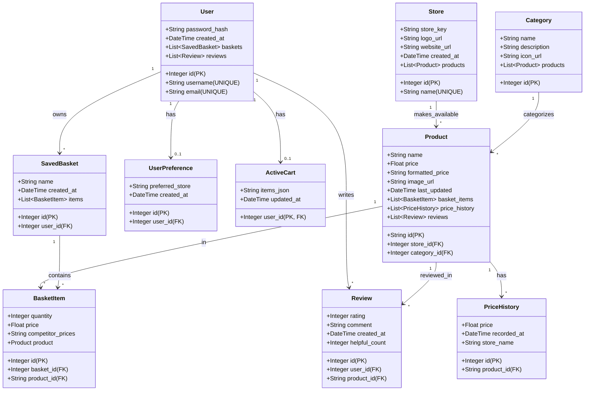

# SmartBasket UML Class Diagram (Draft)

## Core Tables (Original 6)

### User
- Manages user accounts with authentication
- Has many saved baskets and reviews

### Product
- Represents products from different stores
- Tracks price and product information
- Referenced by basket items for price comparison

### UserPreference
- Stores user's preferred store
- One-to-one relationship with User

### ActiveCart
- Tracks the user's current shopping session
- Stores items as JSON

### SavedBasket
- Container for saved shopping baskets
- Contains multiple basket items

### BasketItem
- Individual item in a saved basket
- Links products to baskets

## Additional Tables

### Store
- Manages different supermarket chains (Pick n Pay, Shoprite, Checkers, Woolworths)
- One-to-many relationship with Product
- Tracks store metadata like logos and websites so shoppers know where to find products

### Category
- Organizes products by type (Groceries, Electronics, Clothing, etc.)
- One-to-many relationship with Product
- Improves product discovery and navigation

### PriceHistory
- **Critical for price comparison feature**
- Tracks historical price changes per product per store
- Enables price trend analysis and alerts
- One-to-many relationship with Product

### Review
- User reviews and ratings for products
- Allows users to rate products and leave comments
- Tracks helpful votes on reviews
- Links User, Product together

### In-store shopping
- SmartBasket does not process purchases, orders, or deliveries.
- Products and prices show shoppers which retailer has an item available.
- Users visit the listed store to purchase the items themselves.
- Baskets are shopping lists used for store and price comparison.
